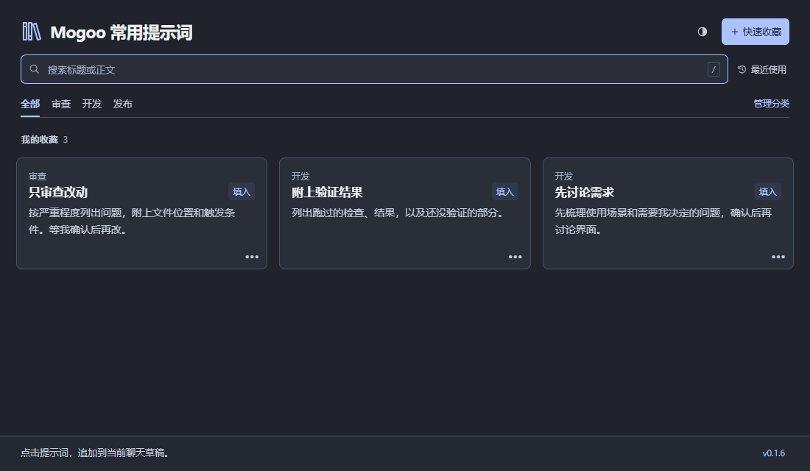

# mogoo-codex-prompts

**English** | [简体中文](README.zh-CN.md)

[Website](https://mogoostudio.github.io/mogoo-codex-prompts/)

Keep the prompts you reuse beside your Codex chat.

Save an instruction once and reuse it across projects. Click a saved prompt to append it to your current draft, then edit and send it from Codex.



[Try the interactive demo: append a saved prompt to a draft](https://mogoostudio.github.io/mogoo-codex-prompts/#demo-title)

## Install

Requires Python 3.10+, Git, and a version of Codex that supports `codex plugin`. Installation has been verified on Windows.

Ask Codex to install the plugin:

```text
Install mogoo-codex-prompts from the mogoo-codex-plugin marketplace at https://github.com/MogooStudio/mogoo-codex-plugin.git.
```

Or run these commands in a terminal. The last command lists installed plugins so you can check the version and enabled status.

```powershell
codex plugin marketplace add https://github.com/MogooStudio/mogoo-codex-plugin.git --ref main --json
codex plugin add mogoo-codex-prompts@mogoo-codex-plugin --json
codex plugin list --marketplace mogoo-codex-plugin --json
```

If you previously installed `mogoo-codex-prompts@mogoo-codex-prompts`, open the new installation in a fresh chat and check your saved prompts. You can then remove the old installation with `codex plugin remove mogoo-codex-prompts@mogoo-codex-prompts --json`. If a marketplace with the same name points elsewhere, follow the [marketplace migration guide](https://github.com/MogooStudio/mogoo-codex-plugin#已登记同名旧目录时).

## First use

1. Open a new Codex chat and select **Mogoo 常用提示词** in the sidebar, or type `打开常用提示词面板`. The panel uses Chinese labels.
2. Choose **快速收藏** (Quick save), paste a prompt, and save it. Leave the title blank to use the first nonempty line.
3. Click the saved prompt. Its text appears after anything already in the current draft. Edit it and send when ready. If the chat does not support inserting drafts, the panel offers **复制** (Copy).

## Features

- Search titles and text, browse favorites by category, or reopen a prompt from **最近使用** (Recently used).
- Use a prompt’s **•••** menu to edit it, change its category, duplicate it, or toggle its favorite status.
- Create categories while saving. Rename or reorder them in **管理分类** (Manage categories).
- Follow the Codex theme or choose light or dark mode. All chats share the collection and appearance setting.

## Updates and local data

Click the version number in the panel footer to check now, toggle automatic checks, or dismiss a release. The updater reads stable `vMAJOR.MINOR.PATCH` tags from this GitHub repository and reuses a successful check for six hours. When you confirm an update, it verifies the marketplace, release tag, and `main` branch before asking Codex to install the package. Open a new chat or restart Codex to load the new version. The panel also provides terminal commands for manual updates. See the [changelog (Chinese)](CHANGELOG.zh.md).

Prompts, categories, recent activity, and appearance are stored in `mogoo-codex-prompts/prompts.sqlite3` under the Codex user directory. Update state is stored separately. The collection stays on this machine when you switch projects or upgrade the plugin.

## Development

The installable package is in [plugin/](plugin/). To run the Python tests and check the panel JavaScript, run these commands from the repository root with Python and Node.js installed:

```powershell
python -B -m unittest discover -s tests
node --check plugin/panel.js
```

Set `MOGOO_PROMPTS_DATA` to a temporary directory when testing with a separate collection. For a release, update both plugin manifests and the changelog, then point the stable version tag and `main` at the same commit. The MCP service and panel read their running version from the package manifest.

## Feedback

For a bug report, include the plugin version shown in the footer, your Codex version, and the steps that reproduce the issue. Use sample text if the problem involves a private prompt. [Open an issue](https://github.com/MogooStudio/mogoo-codex-prompts/issues).
