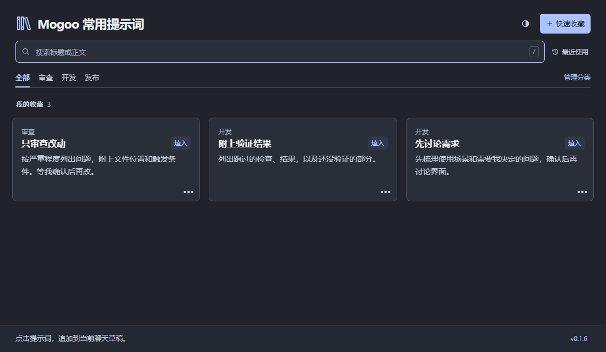

# mogoo-codex-prompts

[English](README.md) | **简体中文**

[网站](https://mogoostudio.github.io/mogoo-codex-prompts/)

把常用提示词放在 Codex 聊天侧栏，跨项目复用。

收藏一条指令后，点击它就能把正文追加到当前草稿。已有文字会保留，你可以继续编辑，再从 Codex 发送。



[试用在线演示：点一条收藏，看它如何追加到草稿](https://mogoostudio.github.io/mogoo-codex-prompts/#demo-title)

## 安装

需要 Python 3.10+、Git 和支持 `codex plugin` 命令的 Codex。已在 Windows 上验证安装。

可以直接让 Codex 安装：

```text
请从 GitHub 上的 mogoo-codex-plugin 插件市场安装 mogoo-codex-prompts，市场地址为 https://github.com/MogooStudio/mogoo-codex-plugin.git。
```

也可以在终端运行以下命令。最后一条会列出已安装的插件，方便核对版本和启用状态。

```powershell
codex plugin marketplace add https://github.com/MogooStudio/mogoo-codex-plugin.git --ref main --json
codex plugin add mogoo-codex-prompts@mogoo-codex-plugin --json
codex plugin list --marketplace mogoo-codex-plugin --json
```

如果之前安装的是 `mogoo-codex-prompts@mogoo-codex-prompts`，先在新聊天里打开新版，核对原收藏，再用 `codex plugin remove mogoo-codex-prompts@mogoo-codex-prompts --json` 移除旧安装。如果已登记的同名市场指向其他地址，参见[市场迁移指南](https://github.com/MogooStudio/mogoo-codex-plugin#已登记同名旧目录时)。

## 第一次使用

1. 新开一个 Codex 聊天，在侧栏选择 **Mogoo 常用提示词**，或输入 `打开常用提示词面板`。
2. 点击 **快速收藏**，粘贴正文并保存。标题留空时，插件会取正文首个非空行作为标题。
3. 点击刚保存的提示词，正文会追加到当前草稿末尾。核对并编辑后自行发送。当前聊天没有草稿写入权限时，可以点 **复制**。

## 功能

- 搜索标题或正文，按分类浏览收藏，也可以从 **最近使用** 找回刚填入的提示词。
- 在条目的 **•••** 菜单里编辑、更改分类、复制为新提示词或切换收藏状态。
- 收藏时可以新建分类。打开 **管理分类** 可以改名或调整顺序。
- 外观可跟随 Codex，也可手动选择浅色或深色。所有聊天共用收藏和外观设置。

## 更新与本机数据

点击面板底部的版本号，可立即检查更新、开关自动检查或忽略某个新版。更新器读取本 GitHub 仓库的稳定版标签 `v主版本.次版本.修订号`，自动检查成功后六小时内复用结果。确认更新后，插件核对市场地址、发行标签和 `main` 分支，再由 Codex 安装。新开聊天或重启 Codex 后生效。需要手动更新时，可以复制面板给出的终端命令。[更新记录](CHANGELOG.zh.md)

收藏、分类、最近使用和外观保存在 Codex 用户目录下的 `mogoo-codex-prompts/prompts.sqlite3`，更新状态单独保存。切换项目或升级插件后仍可使用本机原有收藏。

## 开发

[plugin/](plugin/) 包含可安装的插件。安装 Python 和 Node.js 后，在仓库根目录运行以下命令，执行 Python 测试并检查面板 JavaScript 语法。

```powershell
python -B -m unittest discover -s tests
node --check plugin/panel.js
```

测试时可将 `MOGOO_PROMPTS_DATA` 指向临时目录，使用独立收藏库。发版时同步两份插件清单和更新记录，让稳定版标签与 `main` 指向同一提交。MCP 服务和面板从包内清单读取运行版本。

## 反馈

报告问题时，请附上面板底部的插件版本、Codex 版本和复现步骤。涉及私人提示词时，可以用示例文字复现。[提交 Issue](https://github.com/MogooStudio/mogoo-codex-prompts/issues)
